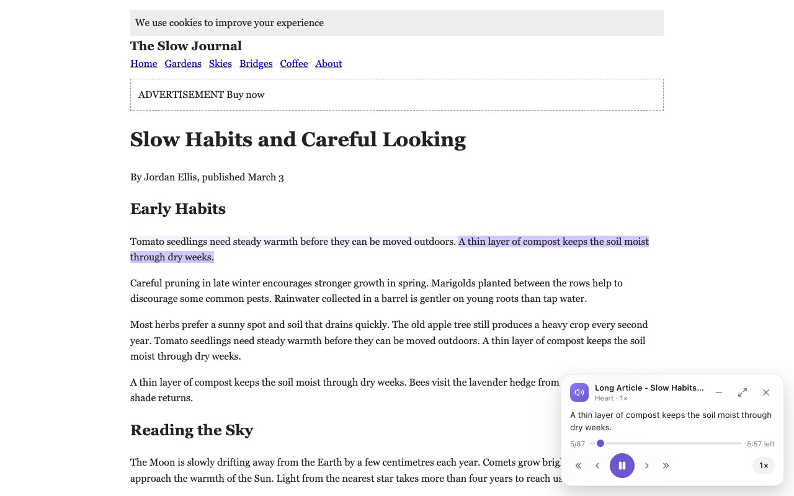

<p align="center"></p>

<h1 align="center">Kokoro Reader</h1>

<p align="center">Listen to any webpage with natural AI speech, generated privately on your own computer.<br>A Chrome extension powered by <a href="https://huggingface.co/hexgrad/Kokoro-82M">Kokoro-82M</a> running locally through ONNX Runtime Web.</p>

<p align="center"></p>

Select a paragraph and click the speaker. Right-click to read a whole page. Open long articles in a clean Smart Reader and listen like an audiobook, with each sentence highlighted as it is spoken. No account, no cloud, no tracking: your text never leaves your device.

## Features

- **Select and listen.** A speaker button appears next to any text selection (Shadow-DOM isolated, follows scrolling, RTL-aware), or right-click → *Read with Kokoro*.
- **Read pages.** Main-content extraction in DOM order that skips navigation, ads, cookie banners and hidden text; start from the top, from the selected paragraph, from a heading, or where you left off.
- **Smart Reader.** Mozilla Readability extraction into a distraction-free view with contents, progress and time remaining.
- **Follow along.** Sentence and paragraph highlighting through the CSS Custom Highlight API (the page's DOM is never modified), with auto-scroll that yields when you scroll.
- **Player everywhere.** In-page player (mini, compact, expanded), popup, and side panel: play/pause, previous/next sentence and paragraph, seek, volume, speed 0.5–3× with natural pitch, voice switching.
- **28 English Kokoro voices** (US and UK) with previews, favorites, recents and voice profiles (docs, news, novels, casual).
- **Listen Later** queue that plays back to back, bookmarks, and optional local history with resume.
- **Your own text.** Paste, type or import `.txt`/`.md`/`.html`, then export a WAV file.
- **Keeps playing** when you switch tabs or close the popup; restores itself if Chrome unloads the audio engine.
- **Keyboard shortcuts**, dark mode, screen-reader labels, reduced motion, high-contrast highlighting.

## How it works

The model runs in a Web Worker inside an MV3 offscreen document. Text is split into sentences, normalized, converted to phonemes with eSpeak NG (WebAssembly), and synthesized one sentence at a time while the previous one plays. Model files come from a pinned Hugging Face revision and are verified by SHA-256 before use. See [docs/ARCHITECTURE.md](docs/ARCHITECTURE.md) for the design and the decision record.

| | 8-bit model on CPU (default) | Full-precision model on WebGPU |
| --- | --- | --- |
| Download | 92 MB | 326 MB |
| First audio (engine warm) | 1.5 s | 0.5 s |
| Real-time factor | 0.95 | 0.22 |
| Speech intelligibility (Whisper WER) | 0 % | 0 % |

Measured on an Apple M4; details and method in [docs/performance](docs/performance/README.md).

## Install

### From a release ZIP

1. Download `kokoro-reader-<version>.zip` from [Releases](https://github.com/SurajMazar/kokoro-reader/releases) and unzip it.
2. Open `chrome://extensions`, turn on **Developer mode**, click **Load unpacked**, and choose the unzipped folder.
3. The welcome page opens. Optionally turn on the speaker button for text selections (this asks for access to all sites) and download the model (92 MB, once).

### From source

Requirements: Node.js 20.19+ (tested with 24), npm, Chrome or Chromium 116+.

```bash
git clone https://github.com/SurajMazar/kokoro-reader.git
```

```bash
cd kokoro-reader && npm ci
```

```bash
npm run build
```

Then load the `dist/` folder with **Load unpacked** as above. Model weights are never committed or bundled; the extension downloads them on first use.

## Development

| Command | What it does |
| --- | --- |
| `npm run dev` | Rebuilds `dist/` on change (reload the extension in `chrome://extensions`) |
| `npm run build` | Typecheck, production build, content-script build, manifest validation |
| `npm run typecheck` / `npm run lint` | TypeScript strict / ESLint |
| `npm test` | Unit and integration tests (Vitest, jsdom, React Testing Library) |
| `npm run build:e2e && npm run test:e2e` | End-to-end tests in real Chromium with the built extension and the real model |
| `npm run benchmark` | Measures download, init, time to first audio, real-time factor, underruns and memory |
| `npm run verify:speech` | Exports speech with every supported variant/backend and transcribes it with Whisper (needs `pip install faster-whisper`) |
| `npm run screenshots` | Regenerates `docs/screenshots/` from the running extension |
| `npm run package` | Zips `dist/` into `release/kokoro-reader-<version>.zip` |
| `npm run pin-model` | Regenerates the pinned model manifest (revision, sizes, SHA-256) |

The E2E build (`dist-e2e/`) declares the all-sites host permission up front, because automated browsers cannot click Chrome's permission prompt. Release builds keep it optional.

### Project layout

```
src/
  background/   service worker: router, session coordinator, menus, commands, permissions, offscreen lifecycle
  content/      content script: selection detector, floating button and player (Shadow DOM), page extraction, highlighting
  offscreen/    offscreen document hosting the engine and audio
  workers/      Kokoro inference worker (transformers.js + ONNX Runtime Web)
  engine/       TTS provider contract, Kokoro provider, phonemizer, voices, speech normalizer, browser-speech fallback
  audio/        playback controller, synthesis queue, fast start, WAV encoding
  models/       pinned manifest, registry, verified model store, model manager
  shared/       message contract and validation, settings, storage, text pipeline, extraction, errors
  popup/ options/ reader/ sidepanel/ welcome/ ui/   React pages and shared UI
tests/          unit, integration, e2e, fixture websites
scripts/        manifest, validation, packaging, model pinning, icons, speech verification, walkthrough
```

## Tests

- **73 unit and integration tests**: text segmentation and normalization, message validation, settings, errors, WAV encoding, the synthesis queue, DOM extraction against the fixture sites, verified downloads with resume and corruption recovery, and the full playback pipeline with a fake engine.
- **11 end-to-end tests** in real Chromium with real inference: select-and-click playback, page reading with highlighting, every player control, cross-tab playback, session replacement without stale audio, recovery after the audio engine is unloaded, dynamic/SPA/RTL pages, floating-button placement in nested scroll containers, the Smart Reader, WAV export validity (header, duration, non-silent), and model cache persistence across a browser restart with corruption recovery.
- **Speech verification**: Whisper transcribes exported audio for each supported configuration (0 % word error rate).

## Known limitations

- **English only.** Kokoro v1.0 has voices for other languages, but they need language-specific phonemizers that were not validated here. Non-Latin text is refused with a clear message instead of being read badly.
- **WebGPU** is used only with the full-precision model; the 8-bit and fp16 models produced garbled audio on WebGPU in testing, so they always run on the CPU. WebGPU results can vary by GPU and driver; a failed test inference falls back to the CPU automatically.
- **Pages Chrome protects** (chrome:// pages, the Web Store, other extensions) cannot be read. The built-in PDF viewer cannot be scripted, but *Read with Kokoro* on a selection there still works (without highlighting).
- **Cross-origin iframes and closed shadow roots** on a page are not extracted; select the text to read it.
- **Highlighting** follows sentences, not individual words.
- **Speed changes** apply instantly through pitch-preserving playback rate; very high speeds may sound processed.
- **Import** supports plain text, Markdown and HTML. PDF and Word files must be converted to text first.
- **Context menu and keyboard shortcuts** are implemented but not exercised by the automated tests (Playwright cannot open native menus or trigger Chrome commands); their code paths are shared with tested ones.
- The **browser speech** fallback depends on the operating system's voices and is not covered by automated tests.
- Not yet published on the Chrome Web Store; listing materials are in [docs/STORE_LISTING.md](docs/STORE_LISTING.md).

## Privacy and security

Text is processed locally and never transmitted. The only network traffic is the one-time model download from Hugging Face, verified by SHA-256. See [PRIVACY.md](PRIVACY.md), [SECURITY.md](SECURITY.md) and [docs/PERMISSIONS.md](docs/PERMISSIONS.md).

## License and credits

Kokoro Reader is licensed under the **GNU GPL v3.0 or later** ([LICENSE](LICENSE)), because it bundles eSpeak NG (GPL-3.0-or-later) through the `phonemizer` package. See [THIRD_PARTY_NOTICES.md](THIRD_PARTY_NOTICES.md).

- Kokoro-82M by hexgrad (Apache-2.0); ONNX export by onnx-community.
- kokoro-js by hexgrad and Xenova (Apache-2.0): voice metadata and the text normalization/phonemization logic ported here.
- transformers.js (Apache-2.0) and ONNX Runtime Web (MIT).
- eSpeak NG (GPL-3.0-or-later) via phonemizer.
- Mozilla Readability (Apache-2.0), React (MIT), Motion (MIT), Lucide icons (ISC), Tailwind CSS (MIT).
